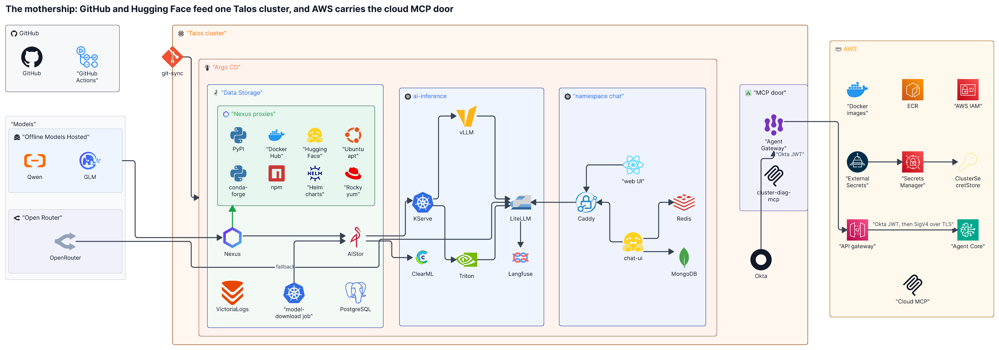

# AI Data Center

## What it does

**A cloud-shaped AI platform you can run on hardware you own: GitOps-managed [Kubernetes](https://kubernetes.io/), governed model serving, and one authenticated gateway for every AI tool, built to lift onto [Amazon EKS](https://docs.aws.amazon.com/eks/latest/userguide/what-is-eks.html).** One Git repository converges it: [Argo CD](https://argo-cd.readthedocs.io/en/stable/) orchestrates it, CI runners build it, secrets and identity govern it, and the data, event lanes and GPU-backed services sit underneath. Push a change and the platform converges, a chat client reaches a model through the LLM gateway, and an AI agent calls a governed tool. It replaces the hand-run scripts, secrets in files and ungoverned tool calls that home and edge labs decay into, and it stages a rated path to Amazon EKS, so regulated private inference, agent workbenches and cloud-style AI operations arrive without cloud GPU bills.

---

## Architecture

*Platform architecture: [GitHub](https://github.com/) and [Hugging Face](https://huggingface.co/) feed the [Talos](https://www.talos.dev/) cluster, the tool plane bridges to [AWS](https://aws.amazon.com/), and the model supply chain runs through the object store.*

## The five-layer cake

NVIDIA founder and CEO Jensen Huang calls AI "essential infrastructure, like electricity and the internet," and describes the buildout as a "five-layer cake" of energy, chips, infrastructure, models and applications. "This layer on top, ultimately, is where economic benefit will happen," he said at the World Economic Forum in Davos in January 2026 ([NVIDIA](https://blogs.nvidia.com/blog/davos-wef-blackrock-ceo-larry-fink-jensen-huang/)). The AI Data Center is all five layers, baked small on hardware you own and shaped to lift onto the cloud. Read bottom-up: each layer rests on the one below it, and every application pulls all the way down to the power plant. The AWS account already holds secrets, events and data, so only compute is on-prem. An EKS target is additive: a new cluster, not a rewrite. Each layer names its on-prem services and their EKS equivalent.

### Chip and energy layer

The base of the cake, and the honest constraint. One host's power and cooling set the ceiling on how much intelligence the platform can produce. This is not a GPU fleet, and the design stays lean because of it. One consumer GPU is passed through to the node and time-sliced across serving, image generation, notebooks and GPU runners, so the same silicon backs every workload above it.

<table>
  <tbody>
    <tr>
      <td width="25%" align="center"> <a href="https://developer.nvidia.com/">NVIDIA GPU</a></td>
      <td width="25%" align="center"> <a href="https://docs.github.com/en/actions/tutorials/actions-runner-controller">GPU runners</a></td>
      <td width="25%" align="center"></td>
      <td width="25%" align="center"></td>
    </tr>
  </tbody>
</table>

### Infrastructure layer

The AI factory, built from Git on  [Kubernetes](https://kubernetes.io/): one commit converges the cluster, and every platform service is declared, not hand-run. Storage, data, networking, security, packaging and observability all run in-cluster, each with a managed AWS twin for the lift to EKS.

<table>
  <thead>
    <tr>
      <th width="50%">On-prem</th>
      <th width="50%">EKS / AWS</th>
    </tr>
  </thead>
  <tbody>
    <tr><td colspan="2" align="center"><strong>Compute and storage</strong></td></tr>
    <tr>
      <td align="center"> <a href="https://www.talos.dev/">Talos</a> &nbsp;|&nbsp;  <a href="https://min.io/">AIStor</a></td>
      <td align="center"><a href="https://docs.aws.amazon.com/eks/latest/userguide/what-is-eks.html">EKS</a> &nbsp;|&nbsp; <a href="https://docs.aws.amazon.com/AmazonS3/latest/userguide/Welcome.html">S3</a></td>
    </tr>
    <tr>
      <td align="center"> <a href="https://www.postgresql.org/">PostgreSQL</a> &nbsp;|&nbsp; <a href="https://www.oracle.com/mysql/">MySQL</a> &nbsp;|&nbsp;  <a href="https://www.mongodb.com/">MongoDB</a></td>
      <td align="center"><a href="https://docs.aws.amazon.com/AmazonRDS/latest/UserGuide/Welcome.html">RDS</a> &nbsp;|&nbsp; <a href="https://docs.aws.amazon.com/documentdb/latest/developerguide/what-is.html">DocumentDB</a></td>
    </tr>
    <tr>
      <td align="center"> <a href="https://redis.io/">Redis</a> &nbsp;|&nbsp;  <a href="https://opensearch.org/">OpenSearch</a></td>
      <td align="center"><a href="https://docs.aws.amazon.com/AmazonElastiCache/latest/dg/WhatIs.html">ElastiCache</a> &nbsp;|&nbsp; <a href="https://docs.aws.amazon.com/opensearch-service/latest/developerguide/what-is.html">Amazon OpenSearch Service</a></td>
    </tr>
    <tr>
      <td align="center"> <a href="https://kafka.apache.org/">Kafka</a> &nbsp;|&nbsp;  <a href="https://www.rabbitmq.com/">RabbitMQ</a></td>
      <td align="center"><a href="https://docs.aws.amazon.com/msk/latest/developerguide/what-is-msk.html">MSK</a> &nbsp;|&nbsp; <a href="https://docs.aws.amazon.com/amazon-mq/latest/developer-guide/welcome.html">Amazon MQ</a></td>
    </tr>
    <tr><td colspan="2" align="center"><strong>Networking and security</strong></td></tr>
    <tr>
      <td align="center"> <a href="https://github.com/kubernetes/git-sync">git-sync</a> &nbsp;|&nbsp;  <a href="https://caddyserver.com/">Caddy</a> &nbsp;|&nbsp; <a href="https://traefik.io/traefik">Traefik</a></td>
      <td align="center"><a href="https://docs.aws.amazon.com/eks/latest/userguide/efs-csi.html">EFS</a> &nbsp;|&nbsp; <a href="https://docs.aws.amazon.com/eks/latest/userguide/aws-load-balancer-controller.html">ALB &nbsp;|&nbsp; NLB</a></td>
    </tr>
    <tr>
      <td align="center"> <a href="https://nlnetlabs.nl/projects/unbound/about/">Unbound</a> &nbsp;|&nbsp;  <a href="https://cert-manager.io/">cert-manager</a> &nbsp;|&nbsp; <a href="https://cert-manager.io/docs/trust/trust-manager/">trust-manager</a></td>
      <td align="center"><a href="https://docs.aws.amazon.com/Route53/latest/DeveloperGuide/Welcome.html">Route 53</a> &nbsp;|&nbsp; <a href="https://docs.aws.amazon.com/acm/latest/userguide/acm-overview.html">ACM</a></td>
    </tr>
    <tr>
      <td align="center"><a href="https://docs.aws.amazon.com/rolesanywhere/latest/userguide/introduction.html">Roles Anywhere</a> &nbsp;|&nbsp;  <a href="https://external-secrets.io/">External Secrets</a></td>
      <td align="center"><a href="https://docs.aws.amazon.com/eks/latest/userguide/pod-identities.html">EKS Pod Identity</a> &nbsp;|&nbsp; <a href="https://aws.amazon.com/secretsmanager/">Secrets Manager</a></td>
    </tr>
    <tr><td colspan="2" align="center"><strong>Package proxies</strong></td></tr>
    <tr>
      <td align="center"> <a href="https://www.sonatype.com/products/sonatype-nexus-repository">Nexus</a> &nbsp;|&nbsp;  <a href="https://pypi.org/">PyPI</a> &nbsp;|&nbsp;  <a href="https://hub.docker.com/">Docker Hub</a> &nbsp;|&nbsp;  <a href="https://huggingface.co/">Hugging Face</a> &nbsp;|&nbsp;  <a href="https://www.npmjs.com/">npm</a> &nbsp;|&nbsp;  <a href="https://helm.sh/">Helm</a></td>
      <td align="center"><a href="https://docs.aws.amazon.com/AmazonECR/latest/userguide/pull-through-cache.html">ECR</a> &nbsp;|&nbsp; <a href="https://docs.aws.amazon.com/codeartifact/latest/ug/welcome.html">CodeArtifact</a></td>
    </tr>
    <tr><td colspan="2" align="center"><strong>Observability</strong></td></tr>
    <tr>
      <td align="center"> <a href="https://docs.victoriametrics.com/victorialogs/">VictoriaLogs</a> &nbsp;|&nbsp; <a href="https://victoriametrics.com/">VictoriaMetrics</a> &nbsp;|&nbsp;  <a href="https://grafana.com/">Grafana</a></td>
      <td align="center"><a href="https://docs.aws.amazon.com/AmazonCloudWatch/latest/logs/WhatIsCloudWatchLogs.html">CloudWatch</a> &nbsp;|&nbsp; <a href="https://docs.aws.amazon.com/grafana/latest/userguide/what-is-amazon-managed-service-for-grafana.html">Amazon Managed Grafana</a></td>
    </tr>
    <tr><td colspan="2" align="center"><strong>Platform</strong></td></tr>
    <tr>
      <td align="center"> <a href="https://argo-cd.readthedocs.io/en/stable/">Argo CD</a> &nbsp;|&nbsp;  <a href="https://airflow.apache.org/">Airflow</a></td>
      <td align="center"><a href="https://docs.aws.amazon.com/eks/latest/userguide/argocd.html">Amazon Argo CD</a> &nbsp;|&nbsp; <a href="https://aws.amazon.com/managed-workflows-for-apache-airflow/">Amazon MWAA</a></td>
    </tr>
  </tbody>
</table>

### Model layer

One OpenAI-compatible URL serves every client, and the model list is the access list. Weights come from [Hugging Face](https://huggingface.co/) through a caching proxy into object storage, or are baked into a versioned image, then served by the inference engines and traced end to end.

<table>
  <tbody>
    <tr><td colspan="4" align="center"><strong>Models</strong></td></tr>
    <tr>
      <td width="25%" align="center"> <a href="https://qwen.ai/">Qwen</a></td>
      <td width="25%" align="center"> <a href="https://github.com/THUDM/GLM-4">GLM</a></td>
      <td width="25%" align="center"> <a href="https://openrouter.ai/">OpenRouter</a></td>
      <td width="25%" align="center"></td>
    </tr>
    <tr><td colspan="4" align="center"><strong>Serving and tracing</strong></td></tr>
    <tr>
      <td align="center"> <a href="https://developer.nvidia.com/triton-inference-server">Triton</a></td>
      <td align="center"> <a href="https://docs.vllm.ai/">vLLM</a></td>
      <td align="center"> <a href="https://kserve.github.io/website/">KServe</a></td>
      <td align="center"> <a href="https://docs.litellm.ai/">LiteLLM</a></td>
    </tr>
    <tr>
      <td align="center"> <a href="https://langfuse.com/">Langfuse</a></td>
      <td align="center"> <a href="https://clear.ml/">ClearML</a></td>
      <td align="center"></td>
      <td align="center"></td>
    </tr>
  </tbody>
</table>

### Application layer

Chat, agent workloads and more than 30 tool servers sit behind one authenticated URL. Agents reach models through the gateway and tools through the MCP door, so their runs are authenticated, governed and traceable. This is where integrated workflows are assembled, and where Huang says economic value happens.

<table>
  <tbody>
    <tr><td colspan="4" align="center"><strong>Surfaces and access</strong></td></tr>
    <tr>
      <td width="25%" align="center"> web UI (<a href="https://react.dev/">React</a>)</td>
      <td width="25%" align="center"> <a href="https://www.okta.com/">Okta</a></td>
      <td width="25%" align="center"> <a href="https://agentgateway.dev/">Agent Gateway</a></td>
      <td width="25%" align="center"> <a href="https://aws.amazon.com/api-gateway/">API Gateway</a></td>
    </tr>
    <tr><td colspan="4" align="center"><strong>Agents and tools</strong></td></tr>
    <tr>
      <td align="center"> <a href="https://aws.amazon.com/bedrock/agentcore/">AgentCore</a></td>
      <td align="center"> <a href="https://modelcontextprotocol.io/">MCP</a></td>
      <td align="center"> <a href="https://www.langchain.com/">LangChain</a></td>
      <td align="center"> <a href="https://www.langchain.com/langgraph">LangGraph</a></td>
    </tr>
    <tr>
      <td align="center"> <a href="https://www.sourcebot.dev/">Sourcebot</a></td>
      <td align="center"> <a href="https://coder.com/">Coder</a></td>
      <td align="center"></td>
      <td align="center"></td>
    </tr>
  </tbody>
</table>

---

## About

Built and operated by <OWNER> as a working reference for running AI the way cloud engineering teams do, on owned hardware, with a documented path to Amazon EKS. Licensed under the [MIT License](LICENSE). This repository is documentation only.
